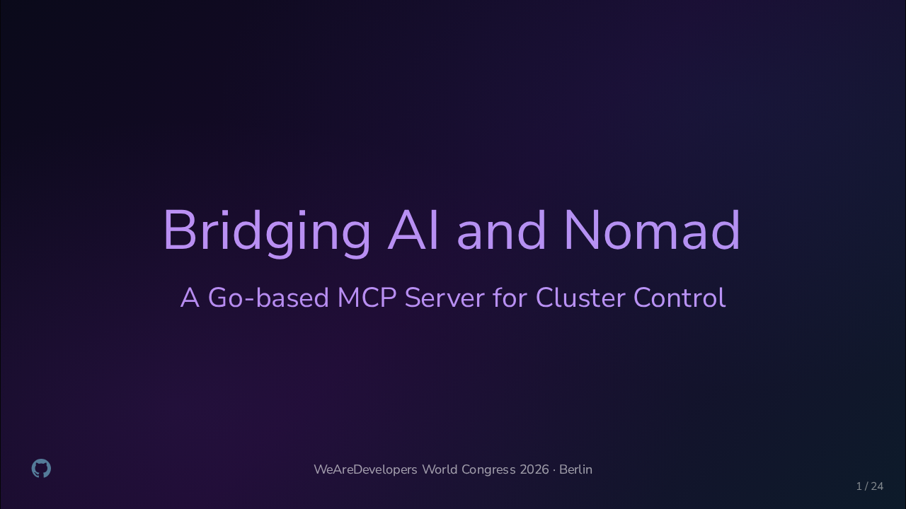

# Bridging AI and Nomad: a Go-based MCP Server for Cluster Control

**Event:** WeAreDevelopers World Congress 2026 · Berlin, 8–10 July 2026

How an MCP server written in Go lets an AI assistant inspect and operate a
HashiCorp Nomad cluster in natural language: jobs, allocations, logs and more.
The live demo runs against a small Nomad + Consul homelab connected with Tailscale.

[](slides-export.pdf)

- **Slides:** [PDF](slides-export.pdf) · source [slides.md](slides.md)
- **Video:** [WeAreDevelopers](https://www.wearedevelopers.com/videos/2063-bridging-ai-and-nomad-a-go-based-mcp-server-for-cluster-control)
- **Project:** [kocierik/mcp-nomad](https://github.com/kocierik/mcp-nomad)

## Demo

| Path | Content |
|---|---|
| [demo/install-local.sh](demo/install-local.sh) | Installs Nomad, Consul, Docker and Tailscale on a Linux host |
| [demo/nomad/](demo/nomad/) | Agent configs and job specs used in the talk (with Traefik) |
| [demo/nomad-no-traefik/](demo/nomad-no-traefik/) | Same setup without Traefik, plus a [demo script](demo/nomad-no-traefik/DEMO-SCRIPT.md) |

## Run the slides

```bash
npm install
npm run dev      # presenter mode
npm run export   # regenerate slides-export.pdf
```
