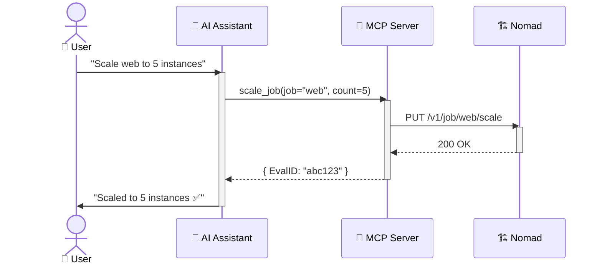

# Bridging AI and Nomad

## A Go-based MCP Server for Cluster Control

<div class="abs-b flex justify-center pb-8 text-sm opacity-60">
  <span>WeAreDevelopers World Congress 2026 · Berlin</span>
</div>

<div class="abs-bl m-6 flex gap-2">
  <a href="https://github.com/kocierik/mcp-nomad" target="_blank" class="text-xl slidev-icon-btn opacity-50 !border-none !hover:text-white">
    <carbon-logo-github />
  </a>
</div>

---
layout: two-cols
class: flex items-center
---

<div class="flex flex-col justify-start h-full pl-8 pt-12">

# About Me

## Erik Koci

<br>

- 🛠️ DevOps Engineer @**Amadeus**
- 📍 Nice, France 🇫🇷
- ☁️ Infrastructure & Cloud
- 🤖 AI tooling

<div class="flex flex-wrap gap-6 mt-6">
  <a href="https://github.com/kocierik" target="_blank" class="flex items-center gap-2 px-3 py-1.5 rounded-full border border-purple-500/50 bg-purple-900/20 text-sm hover:bg-purple-800/30 transition-colors"><carbon-logo-github /> kocierik</a>
  <a href="https://www.linkedin.com/in/erik-koci-556937218" target="_blank" class="flex items-center gap-2 px-3 py-1.5 rounded-full border border-blue-500/50 bg-blue-900/20 text-sm hover:bg-blue-800/30 transition-colors"><carbon-logo-linkedin /> erik-koci</a>
  <a href="mailto:erik@teapot.ovh" class="flex items-center gap-2 px-3 py-1.5 rounded-full border border-green-500/50 bg-green-900/20 text-sm hover:bg-green-800/30 transition-colors"><carbon-email /> erik@teapot.ovh</a>
</div>

</div>

::right::

<div class="flex items-center justify-center h-full">
  
</div>

---
layout: default
---

# Agenda

0. 🏗️ **What is HashiCorp Nomad?** — The orchestrator
1. 🔌 **What is MCP?** — The protocol bridging AI and tools
2. 🧭 **LLM Skills** — Custom workflows; repeatable across platforms
3. 💡 **The Problem** — Why this project exists
4. 🧱 **Architecture** — How mcp-nomad is built
5. 🔐 **Security** — AI meets infrastructure (defense in depth)
6. ⚙️ **Key Design Choices** — Trade-offs and lessons
7. 🎬 **Live Demo** — MCP + browser (ingress proof)
8. 📚 **Lessons Learned**

---
layout: section
---

# What is HashiCorp Nomad?

---

# HashiCorp Nomad

<div class="grid grid-cols-2 gap-8">
<div>

### A workload orchestrator

<v-click>

- Deploy **containers**, **binaries**, **VMs**, **batch jobs**
- Single binary, lightweight
- Multi-region, multi-datacenter
- Integrates with Consul, Vault
- **Not just containers** — unlike Kubernetes

</v-click>
</div>
<div>

### Why Nomad?

<v-click>

- ✅ Simple to operate
- ✅ Flexible workloads (Docker, exec, Java, QEMU...)
- ✅ Lower operational overhead than K8s
- ✅ Proven at scale (millions of containers)
- ✅ Rich REST API at `/v1/`

</v-click>

</div>
</div>

<br>

<v-click>

```hcl
job "web" {
  group "app" {
    task "server" {
      driver = "docker"
      config { image = "nginx:latest" }
    }
  }
}
```

</v-click>

---
layout: section
---

# What is MCP?

---

# Model Context Protocol (MCP)

<div class="grid grid-cols-1 gap-8">
<div>

### The "USB-C for AI"

An open protocol by Anthropic that lets AI models **interact with external tools and data sources** in a standardized way.

<v-click>

- 📋 **Tools** — Functions the AI can call
- 📄 **Resources** — Data the AI can read
- 💬 **Prompts** — Templates for common workflows
- 🔄 **Transports** — stdio, SSE, HTTP

</v-click>
<br>
<v-click>

<div class="flex justify-center items-center gap-3 mt-4">
  <div class="p-4 border-2 border-blue-400 rounded-xl bg-blue-900/20 text-center">
    <div class="text-2xl">🤖</div>
    <strong class="text-blue-300 text-sm">AI Assistant</strong>
  </div>
  <div class="flex flex-col items-center gap-1">
    <span class="text-green-400 text-lg">— MCP Protocol —▶</span>
    <span class="text-green-400 text-lg opacity-50">◀— Response ——</span>
  </div>
  <div class="p-4 border-2 border-green-400 rounded-xl bg-green-900/20 text-center">
    <div class="text-2xl">🔌</div>
    <strong class="text-green-300 text-sm">MCP Server</strong>
  </div>
  <div class="flex flex-col items-center gap-1">
    <span class="text-purple-400 text-lg">— API calls —▶</span>
    <span class="text-purple-400 text-lg opacity-50">◀— Response —</span>
  </div>
  <div class="p-4 border-2 border-purple-400 rounded-xl bg-purple-900/20 text-center">
    <div class="text-2xl">🏗️</div>
    <strong class="text-purple-300 text-sm">External System</strong>
  </div>
</div>
<br>

> Instead of the AI just *talking* about infrastructure, it can **actually manage** it.

</v-click>

</div>
</div>

---

# LLM Skills

<div class="grid grid-cols-1 gap-8">
<div>

### Custom workflows, repeatable across platforms


- **What they are** — customizable workflows that teach an LLM **how** to run a task **your way**.
- **Why they help** — **repeatable**, **standardized** runs instead of ad‑hoc prompts every time.
- **Where they live** — often **markdown** in the repo (e.g. `SKILL.md`), tracked like normal source.
- **How they attach** — the **host** loads the matching skill when your task fits; text is **merged into the prompt**.

<br>
<v-click>
<div class="flex justify-center items-center gap-3 mt-4">
  <div class="p-4 border-2 border-green-400 rounded-xl bg-green-900/20 text-center">
    <div class="text-2xl">📋</div>
    <strong class="text-green-300 text-sm">Skill · SKILL.md</strong>
  </div>
  <div class="flex flex-col items-center gap-1">
    <span class="text-green-400 text-lg">— merge into prompt —▶</span>
    <span class="text-green-400 text-lg opacity-50">◀— workflow text ——</span>
  </div>
  <div class="p-4 border-2 border-blue-400 rounded-xl bg-blue-900/20 text-center">
    <div class="text-2xl">🤖</div>
    <strong class="text-blue-300 text-sm">AI Assistant</strong>
  </div>
  <div class="flex flex-col items-center gap-1">
    <span class="text-purple-400 text-lg">— same steps —▶</span>
    <span class="text-purple-400 text-lg opacity-50">◀— every match —</span>
  </div>
  <div class="p-4 border-2 border-purple-400 rounded-xl bg-purple-900/20 text-center">
    <div class="text-2xl">✅</div>
    <strong class="text-purple-300 text-sm">Standardized run</strong>
  </div>
</div>
</v-click>
</div>
</div>

---
layout: section
---

# The Problem

---

# The Problem

<div class="grid grid-cols-2 gap-12 mt-4">
<div>

### The Pain 😩

- Managing Nomad means **CLI + UI + API juggling**
- Context switching between terminal and docs
- Repetitive operations (drain node, check logs, restart...)
- Junior devs struggle with complex operations
- **No MCP server existed for Nomad**

</div>
<div v-click>

### The Vision 🚀

- Talk to your cluster in **natural language**
- AI understands context and can chain operations
- One interface for **50 operations** across the entire cluster
- Safe, auditable, with guardrails
- Bridge the gap between AI and infrastructure

</div>
</div>

---
layout: section
---

# Architecture

---
layout: center
---

# Architecture — Request Flow



---

# Transport Modes

Three ways to connect — pick what fits your setup:

<div class="grid grid-cols-3 gap-6 mt-4">
<v-click>
<div class="p-4 border rounded-lg">

### 📟 stdio
Default mode. AI spawns the binary directly.

```bash
./mcp-nomad
```

Best for: **local dev, Claude Desktop**

</div>
</v-click>
<v-click>
<div class="p-4 border rounded-lg">

### 📡 SSE
Server-Sent Events over HTTP.

```bash
./mcp-nomad \
  --transport sse \
  --port 8080
```

Best for: **web integrations**

</div>
</v-click>
<v-click>
<div class="p-4 border rounded-lg">

### 🌐 Streamable HTTP
Full HTTP streaming.

```bash
./mcp-nomad \
  --transport streamable-http \
  --port 8080
```

Best for: **production**

</div>
</v-click>
</div>

---

# 50 MCP Tools — Full Cluster Coverage

<div class="grid grid-cols-4 gap-4 text-xs mt-2">

<div>

### Jobs (10)
- `list_jobs`
- `get_job`
- `run_job`
- `stop_job`
- `scale_job`
- `get_job_allocations`
- `get_job_evaluations`
- `get_job_deployments`
- `get_job_summary`
- `get_job_services`

### Namespaces (3)
- `list_namespaces`
- `create_namespace`
- `delete_namespace`

</div>

<div>

### Nodes (4)
- `list_nodes`
- `get_node`
- `drain_node`
- `eligibility_node`

### Allocs (3)
- `list_allocations`
- `get_allocation`
- `stop_allocation`

### Logs (1)
- `get_allocation_logs`

### Sentinel (4)
- `list_sentinel_policies`
- `get_sentinel_policy`
- `create_sentinel_policy`
- `delete_sentinel_policy`

</div>

<div>

### ACL (13)
- `list_acl_tokens`
- `get_acl_token`
- `create_acl_token`
- `delete_acl_token`
- `list_acl_policies`
- `get_acl_policy`
- `create_acl_policy`
- `delete_acl_policy`
- `list_acl_roles`
- `get_acl_role`
- `create_acl_role`
- `delete_acl_role`
- `bootstrap_acl_token`

</div>

<div>

### Variables (4)
- `list_variables`
- `get_variable`
- `create_variable`
- `delete_variable`

### Volumes (3)
- `list_volumes`
- `get_volume`
- `delete_volume`

### Cluster (3)
- `get_cluster_leader`
- `list_cluster_peers`
- `list_regions`

</div>

</div>

---

# Code — From Tool to Nomad API

<div>

### 1. Register tool & handler

```go {all|1-5|7-10|11-16}
// tools/jobs.go
listJobsTool := mcp.NewTool("list_jobs",
    mcp.WithDescription("List all jobs"),
    mcp.WithString("namespace", ...),
)

s.AddTool(listJobsTool, func(ctx context.Context,
    req mcp.CallToolRequest) (*mcp.CallToolResult, error) {
    return client.ListJobs(ctx, namespace, status)
})

// client/nomad.go
func (c *NomadClient) ListJobs(ctx context.Context,
    ns, status string) ([]types.JobSummary, error) {
    return c.makeRequest(ctx, "GET", "jobs", params, nil)
}

```

</div>

> Same pattern for all 50 tools — **one file per domain, one interface per API client**.

---

# Security — AI Meets Infrastructure

When an AI can **modify your cluster**, security is not optional.

<div class="grid grid-cols-2 gap-8 mt-4">
<div>

<v-click>

### 🔒 Restricted HTTP Client
Only **pre-approved API paths** can be called — no arbitrary requests to Nomad.
</v-click>

<v-click>

### 🔑 Token-based Authentication
`NOMAD_TOKEN` passed as header on every request. Supports ACL policies.

</v-click>

<v-click>

### 🌐 Origin Validation
HTTP transports validate request origins — only trusted sources allowed.

</v-click>

</div>
<div>

<v-click>

### 🛡️ TLS Support
Full TLS with CA certificates, skip-verify option, and server name validation.
</v-click>

<v-click>

### ⏱️ Timeouts & Limits
30s read/write, 60s idle — prevents hanging connections and abuse.

</v-click>

<v-click>

### 📋 Nomad ACL Integration
The server respects Nomad's ACL system — the AI can only do what the token allows.

</v-click>

</div>
</div>

---

# Key Design Choices

<div class="grid grid-cols-2 gap-8 mt-4">
<div>

### ✅ What worked well

<v-click>

- **Interface segregation** → easy to test & mock
- **Same env vars as Nomad CLI** → familiar DX
- **mcp-go library** → solid MCP protocol implementation
- **Multi-transport** → flexible deployment options
- **Single binary distribution** → Go cross-compilation + NPM + Docker

</v-click>

</div>
<div>

### ⚠️ Trade-offs

<v-click>

- 50 tools = large context window usage for AI
- **Authorization** is still **Nomad ACL** (via `NOMAD_TOKEN`); mcp-nomad adds **HTTP path allow-listing** — not a second in-process RBAC engine
- No streaming logs yet (follow mode limited)

</v-click>

</div>
</div>

---
layout: section
---

# 🎬 Live Demo

---
layout: center
class: text-center
---

# Demo Setup

<div class="grid grid-cols-3 gap-8 mt-8 text-left">

<div class="p-4 border rounded-lg text-center">
  <div class="text-4xl mb-2">🖥️</div>
  <strong>nomad cluster</strong>
  <p class="text-sm opacity-70">real agents (server + laptop pool)</p>
</div>

<div class="p-4 border rounded-lg text-center">
  <div class="text-4xl mb-2">🔌</div>
  <strong>mcp-nomad</strong>
  <p class="text-sm opacity-70">stdio — same token ACL as CLI</p>
</div>

<div class="p-4 border rounded-lg text-center">
  <div class="text-4xl mb-2">🤖</div>
  <strong>claude desktop</strong>
  <p class="text-sm opacity-70">assistant with MCP enabled</p>
</div>

</div>

<br>

<div class="mt-4 text-left max-w-lg mx-auto">

```json
{
  "mcpServers": {
    "mcp_nomad": {
      "command": "npx",
      "args": ["-y", "@kocierik/mcp-nomad"],
      "env": { 
        "NOMAD_ADDR": "http://127.0.0.1:4646",
        "NOMAD_TOKEN": "your-token"  // Optional if ACL is off
      }
    }
  }
}
```

</div>

---
layout: default
---

# Demo Scenarios

<v-click>

### 1️⃣ Explore
> *"List jobs in the default namespace and summarize what each one does."* → <code>list_jobs</code>
</v-click>

<v-click>

### 2️⃣ Correlate ingress ↔ workload
> *"Show allocations for job <code>traefik</code> and for <code>laptop-echo</code>."* → ties MCP to the URL you open in the browser.
</v-click>

<v-click>

### 3️⃣ Troubleshoot like SRE
> *"Get recent stderr logs for a <code>service</code> allocation — look for errors."* → <code>get_allocation_logs</code>

</v-click>

<v-click>

### 4️⃣ Deploy something safe
> *"Register a small disposable service job (e.g. http-echo or whoami) with count 1."* → <code>run_job</code> + HCL

</v-click>

<v-click>

### 5️⃣ Scale
> *"Scale that disposable job to 3 instances"* → <code>scale_job</code>

</v-click>

<v-click>

### 6️⃣ Operate (optional / dev only)
> *"Drain node (ID …) with a short deadline"* → <code>drain_node</code> — **skip on shared prod**; use a lab node or narrative only.

</v-click>

---

# Demo Time! 🚀

<div class="text-center mt-16">
  <div class="text-8xl mb-8">🎬</div>
  <p class="text-2xl opacity-80">Switching to live demo...</p>
</div>

<!--
DEMO NOTES (speaker):
1. MCP panel visible: Claude Desktop or Cursor with mcp-nomad connected; NOMAD_ADDR correct for the cluster you use.
2. Start with list_jobs → name traefik, pairdrop, laptop-echo (or your subset).
3. Browser: open your rehearsed HTTPS URL (whoami / echo-demo path) — point at X-Forwarded-* on screen.
4. get_allocation_logs on traefik: short tail; mention "same tools you'd use from CLI, but via natural language".
5. Optional: run_job disposable echo/whoami OR scale_job only on a throwaway job — avoid draining shared infrastructure.
6. If Wi‑Fi fails: walk through frozen screenshots or this deck's "If Something Breaks" slide as narrative.
7. PairDrop / Immich: deep dives only if time; use demo-replica-problemi.md in repo for war stories (HTTP/2 upload, WS fallback, DNS).
-->

---
layout: section
---

# Lessons Learned

---

# Lessons Learned

<v-click>

### 🧠 AI needs good tool descriptions
**MCP tool descriptions** drive **tool choice**. Keep them **short** and **precise**.
</v-click>

<v-click>

### 🎯 AI context window is precious
**50 tools** burn **context**. **Tight names** + **tight blurbs** → **faster picks**.
</v-click>

<v-click>

### 🔐 Operational security
**MCP token** = **service identity** (like CI): **least privilege**, **short TTL**, **per env**.

</v-click>

<v-click>

### 📦 Distribution matters
**NPM** + **Docker** + **single binary** → **maximum reach**.

</v-click>

---
layout: center
class: text-center
---

# Thank You!

<div class="text-xl mt-4 opacity-80">

**Bridging AI and Nomad: a Go-based MCP Server for Cluster Control**

</div>

<div class="flex justify-center items-start gap-16 mt-6">

<div class="flex flex-col gap-3 text-left mt-10">
  <a href="https://github.com/kocierik/mcp-nomad" class="flex items-center gap-2 px-3 py-1.5 rounded-full border border-purple-500/50 bg-purple-900/20 text-sm"><carbon-logo-github /> kocierik/mcp-nomad</a>
  <a href="https://www.linkedin.com/in/erik-koci-556937218" class="flex items-center gap-2 px-3 py-1.5 rounded-full border border-blue-500/50 bg-blue-900/20 text-sm"><carbon-logo-linkedin /> erik-koci</a>
  <a href="mailto:erik@teapot.ovh" class="flex items-center gap-2 px-3 py-1.5 rounded-full border border-green-500/50 bg-green-900/20 text-sm"><carbon-email /> erik@teapot.ovh</a>
</div>

<div class="flex flex-col items-center gap-2">
  
  <span class="text-xs opacity-60">github.com/kocierik/mcp-nomad</span>
</div>

</div>


<div class="opacity-60 text-sm mt-15">
  WeAreDevelopers World Congress 2026 · Berlin
</div>