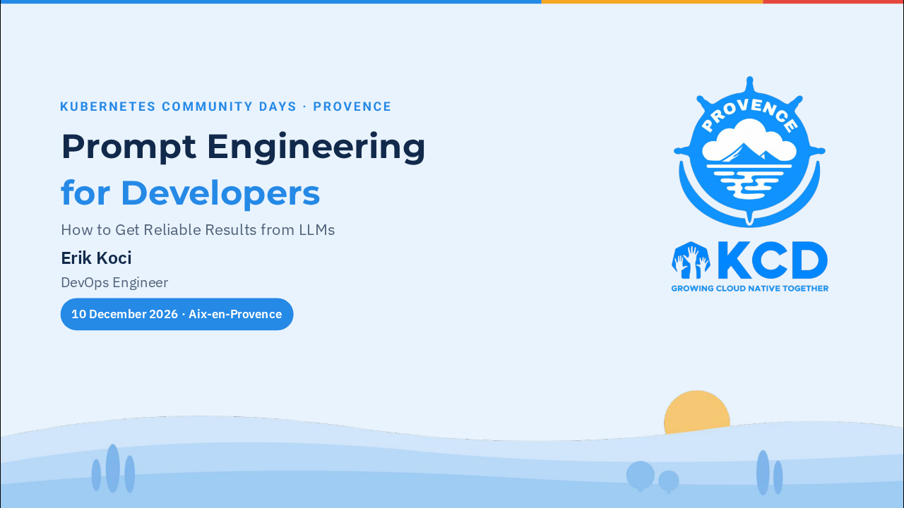

# Prompt Engineering for Developers: How to Get Reliable Results from LLMs

**Event:** Kubernetes Community Days Provence 2026 · Aix-en-Provence, 10 December 2026

An AI answer can sound convincing and still be wrong. This talk shows how to make
LLM output testable: clear task contracts, context and state, reusable skills,
the agent harness, and evals, with examples from cloud-native work.

[](slides-30min-export.pdf)

- **Slides (30 min):** [PDF](slides-30min-export.pdf) · source [slides-30min.md](slides-30min.md)
- **Slides (10 min):** [PDF](slides-10min-export.pdf) · source [slides-10min.md](slides-10min.md)
- **Speaker notes and outlines:** [notes/](notes/)

## Demo

| Path | Content |
|---|---|
| [demo/codebase-explainer/](demo/codebase-explainer/) | Sample codebase and the `explain-codebase` skill installed live |
| [demo/prompt-comparison.md](demo/prompt-comparison.md) | Vague vs. structured prompt |
| [demo/kubernetes-debugging-fixture.md](demo/kubernetes-debugging-fixture.md) | Kubernetes debugging scenario |
| [demo/live-update-fallback.md](demo/live-update-fallback.md) | Fallback if the live demo fails |

## Run the slides

```bash
npm install
npm run dev:30      # 30-minute version
npm run dev:10      # 10-minute version
npm run export:30   # regenerate slides-30min-export.pdf
npm run export:10   # regenerate slides-10min-export.pdf
```

Slides use a fixed 16:9 canvas. When changing layouts, check that content stays
above the footer in both short and tall browser windows and in the PDF export.
