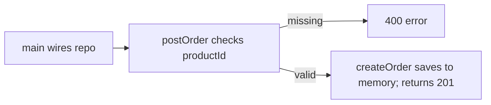

# Codebase Explainer Demo — Prepared Output

Prepared, illustrative sample project. It is not production code and contains
no private repository data.

## Prepared reference / fallback (not live activation)

The question, diagram, and evidence below are prepared output, not a live
Copilot response. They are reference/fallback material only and are not shown
as part of the 16:00–20:00 install-only lifecycle segment.

### Prepared question

> How does `postOrder` handle a missing or valid product ID, and where does a
> valid order end up?

### Prepared Mermaid diagram



### Prepared evidence-linked explanation

- `main` in `sample/src/main.ts` creates an `InMemoryOrderRepository` and
  passes it to `postOrder`.
- `postOrder` in `sample/src/routes/postOrder.ts` returns status 400 when
  `productId` is missing. Otherwise it awaits `createOrder` and returns
  status 201 with the resulting order.
- `createOrder` in `sample/src/orders/createOrder.ts` builds a pending order,
  awaits `repository.save(order)`, then returns the order.
- `OrderRepository` in `sample/src/orders/OrderRepository.ts` defines the
  `save` contract. `InMemoryOrderRepository.save` in
  `sample/src/orders/InMemoryOrderRepository.ts` appends the order to its
  `orders` array.
- The prepared entry point uses in-memory storage; it does not demonstrate a
  network server or durable database.

## Preparation (outside the 16:00–20:00 segment)

Before the talk, prewarm and verify the CLI:

```powershell
npx -y skills --help
```

Expected: the CLI prints its usage text and exits successfully. This
preparation does not replace the live install command.

## Presenter instructions

From the conference project root, run only this command during the merged
lifecycle segment:

```powershell
npx -y skills add (Resolve-Path .\demo\codebase-explainer\skills).Path --skill explain-codebase
```

`Resolve-Path` supplies an absolute local Windows path. `npx -y` skips only
npx's package confirmation; there is no `--agent` or final CLI `-y`.
Choose **Project** and **GitHub Copilot** in interactive prompts when offered.
The expected project location is `.agents/skills/explain-codebase`; preserve
existing skills and every existing `skills-lock.json` entry if the CLI adds
the matching `explain-codebase` entry. Describe installation as successful
only when supported by the CLI result; installation does not prove activation.

If installation or network access fails, report the failure honestly and
continue the lifecycle/dependency takeaway. Do not claim the skill was
installed or activated. The prepared reference above is available as an
explicitly labeled fallback, not a substitute for successful installation.

## 16:00–20:00 walkthrough (four minutes, install only)

- **16:00–17:00 — Lifecycle:** “Find → create → test → share. A skill packages
  a repeatable method; explain-codebase is our prepared, read-only example.”
- **17:00–18:30 — Install and prompts:** Run the approved command. “Resolve-Path
  supplies the absolute local source. I choose Project and GitHub Copilot when
  offered; the CLI prompts stay interactive.”
- **18:30–19:00 — Result and boundary:** Report the actual CLI result.
  “This demonstrates installation only, not activation or an answer from
  Copilot.” If the command fails or remains incomplete, say so.
- **19:00–20:00 — Dependency takeaway:** “A skill changes agent behavior:
  pin it, review it, diff it. Too many vague skills mean noisy triggers;
  prefer fewer, sharper ones.”

Do not submit the prepared question or show the answer diagram in this
timed segment. Keep both in the prepared reference/fallback section.
