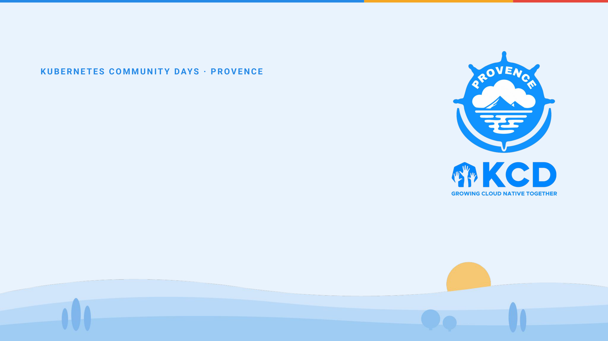

  
  
From Prompts to Harnesses:

  
Engineering Reliable AI Agents

  
How to Get Reliable Results from LLMs

  
Erik Koci

  
DevOps Engineer

  
10 December 2026 · Aix-en-Provence

---

SPEAKER / KCD PROVENCE

  
  

    <h1 class="speaker-intro-name">Erik Koci</h1>
    
DevOps Engineer

    

      
1Passionate about AI, cloud, and open-source

      
2Double master's degree from Polytech Sophia Antipolis and University of Bologna

      
3Speaker at WeAreDevelopers World Congress 2026 in Berlin and HashiCorp conferences

    

    
github.com/kocierik · erik.man.ovh

  

SPEAKER INTRODUCTION#KCDProvence · 10 Dec 2026 · Aix-en-Provence

---

QUICK POLL

Raise your hand if an AI gave you 
a confident fix that was wrong.

  

IT SOUNDED RIGHT

Fluent, structured, convincing.

  

IT WAS NOT CHECKED

No evidence, no test, no proof.

  

TODAY

How to turn plausible answers into verifiable results.

ONE INCIDENT, FOLLOWED FOR 30 MINUTES00

---

AGENDA / FIVE LAYERS

Prompt engineering did not disappear. 
It became one layer of the system.

  
1 PROMPT

→

  
2 CONTEXT

→

  
3 SKILLS

→

  
4 AGENTS

→

  
5 HARNESS

  

PROMPT

What exactly am I asking?

  

CONTEXT

What does the model see, now and next session?

  

SKILLS

How does my team do this?

  

AGENTS

Who decides the next step?

  

HARNESS

Where can it act — and how do we prove it worked?

ONE INCIDENT, FIVE LAYERSAGENDA

---

1 / PROMPT · THE VAGUE PROMPT

<h2>A vague prompt leaves room for a confident guess.</h2>

  
$ developer@laptop:~$

  
Why is my Kubernetes pod crashing? Fix it.

  
THE MODEL MUST GUESS

  
Which evidence matters? What is allowed? What counts as fixed?

POSSIBLE FAILURE MODES

  

UNPROVEN CAUSE

A guess presented as fact

  

SKIPPED EVIDENCE

Checks never requested

  

PREMATURE ACTION

Changes before checks

  

WEAK VERIFICATION

Only the symptom clears

TRACE FACTS BEFORE CHANGING PRODUCTION1 · PROMPT

---

1 / PROMPT · ANATOMY OF A GOOD PROMPT

<h2>Build a prompt you can verify.</h2>

  

    
01 / GOAL

    
Investigate without claiming an unsupported root cause.

  

  

    
02 / EVIDENCE

    
3 pods crash; exit 1; generic config error. Events and effective config are unknown.

  

  

    
03 / LIMITS

    
Read-only investigation. No destructive changes.

  

  

    
04 / OUTPUT

    
Facts, hypotheses, missing evidence, checks, safe next action.

  

  

    
05 / VERIFY

    
State what confirms or falsifies the leading hypothesis.

  

BUILD THE CONTRACT, THEN RUN IT<a class="skill-link" href="https://platform.openai.com/chat/edit?optimize=true" target="_blank" rel="noopener noreferrer">OPENAI PROMPT OPTIMIZER</a>1 · PROMPT

---

2 / CONTEXT · WHAT THE MODEL SEES

<h2>The prompt is only one part of the context.</h2>

  

    
INSTRUCTIONS

    

GOAL

intent + boundaries

  

  
+

  

    
EVIDENCE

    

STATE

logs + config + history

  

  
+

  

    
CAPABILITIES

    

TOOLS

MCP + shell + APIs

  

  
+

  

    
PROCEDURE

    

SKILLS

how this team works

  

  
<b>Engineering question:</b> What information should exist in the model's context right now?

<!-- 
Anthropic, “Effective context engineering for AI agents” (Sep 2025): context is a finite resource and includes the broader state available to the model.
 -->

WRITE CONTEXT AGENTS CAN USE2 · CONTEXT

---

2 / CONTEXT · A FINITE BUDGET

More context is not better context. Relevant context is.

  

    
NOISE

    
10,000 lines of logs from every pod

    
The whole repository “just in case”

    
Stale runbooks and old chat history

  

  

    
SIGNAL

    
The last previous-container log lines

    
The manifest + the recent change

    
An explicit list of what is still missing

  

  
Every token competes for attention. <b>Load evidence just in time</b>, through tools.  
  <a class="skill-link" href="https://github.com/rtk-ai/rtk" target="_blank" rel="noopener noreferrer">RTK</a> compresses CLI output before it reaches the model.

CONTEXT IS A RESOURCE, NOT A DUMPING GROUND<a class="skill-link" href="https://github.com/rtk-ai/rtk" target="_blank" rel="noopener noreferrer">https://github.com/rtk-ai/rtk</a> 2 · CONTEXT

---

2 / CONTEXT · ACROSS SESSIONS

<h2>What happens when the task lasts longer than one context window?</h2>

  

    
SESSION 1

    

DISCOVER

inspect  / evidence / plan

  

  
→

  

    
CHECKPOINT

    

ARTIFACTS

state / notes / tests / TODO

  

  
→

  

    
SESSION 2

    

RESUME

reconstruct  context

  

  
→

  

    
DONE

    

VERIFY

prove the outcome

  

  
Context management is no longer a prompt trick. It is part of <b>state management</b>.

SAVE STATE FOR THE NEXT SESSION<a class="skill-link" href="https://github.com/mattpocock/skills/blob/main/skills/productivity/handoff/SKILL.md" target="_blank" rel="noopener noreferrer">https://github.com/mattpocock/skills/blob/main/skills/productivity/handoff/SKILL.md</a>2 · CONTEXT

---

2 / CONTEXT · TOOLS FOR STATE

<h2>Put the state outside the model.</h2>

  

    
BEADS

    
Task graph with dependencies

    
What is left, what is blocked, what is ready next.

  

  

    
CLAUDE-MEM

    
Compressed session memory

    
What happened last time, injected into the next session.

  

  

    
SPEC KIT

    
Spec → plan → tasks as files

    
Why we are doing it, versioned in the repo.

  

  
The context window is <b>temporary memory</b>. Record decisions and next steps in the repo, so work can continue across sessions.

TRACK LONG-HORIZON WORK<a class="skill-link" href="https://github.com/obra/superpowers" target="_blank" rel="noopener noreferrer">https://github.com/obra/superpowers</a>2 · CONTEXT

---

3 / SKILLS · PACKAGED EXPERTISE

Don't repeat expertise in every prompt.

  

    
skills/k8s-incident/

    

SKILL.md 
references/ 
&nbsp;&nbsp;runbook.md 
&nbsp;&nbsp;service-map.md 
scripts/ 
&nbsp;&nbsp;collect_evidence.sh
    

  

  

    
PACKAGED EXPERTISE

    

      

METHOD

Procedures

      

KNOWLEDGE

References

      

AUTOMATION

Deterministic scripts

      

GUARDRAILS

Domain constraints

      

PROOF

Validation steps

    

  

  
GENERAL MODEL

+

SKILL

→

SPECIALIZED CAPABILITY

<!-- 
Skills can be discovered and loaded only when relevant, keeping specialized expertise composable instead of permanently stuffing it into the prompt.
 -->

CREATE AND TEST REUSABLE SKILLS<a class="skill-link" href="https://github.com/anthropics/skills/blob/main/skills/skill-creator/SKILL.md" target="_blank" rel="noopener noreferrer">https://github.com/anthropics/skills/blob/main/skills/skill-creator/SKILL.md</a>3 · SKILLS

---

3 / SKILLS · INSIDE A SKILL.md

<h2 style="margin-bottom:0">A skill is just a file the agent loads when relevant.</h2>

  

--- 
name: k8s-incident 
description: Use when a workload is crashing 
&nbsp;&nbsp;or unhealthy in a production namespace. 
--- 
## Procedure 
1. Run scripts/collect_evidence.sh (read-only) 
2. Separate facts from hypotheses 
3. For each hypothesis, name a falsifying check 
## Rules 
- Never mutate prod without human approval 
## Done when 
- Root cause backed by evidence 
- Rollout healthy + regression check passes
  

  

    

DESCRIPTION = TRIGGER

Only the name and description sit in context until the task matches.

    

PROCEDURE = METHOD

The steps your senior SRE would follow.

    

RULES = GUARDRAILS

What must never happen, written once.

    

DONE WHEN = PROOF

The agent knows when to stop — and what to prove.

  

PROGRESSIVE DISCLOSURE: LOAD EXPERTISE ON DEMAND<a class="skill-link" href="https://github.com/vercel-labs/skills/blob/main/skills/find-skills/SKILL.md" target="_blank" rel="noopener noreferrer">https://github.com/vercel-labs/skills/blob/main/skills/find-skills/SKILL.md</a>3 · SKILLS

---

3 / SKILLS · LIFECYCLE

<h2>Manage skills like code.</h2>

  

    
FIND

    

REUSE

search before write one

  

  
→

  

    
CREATE

    

SCOPE

one job · precise description

  

  
→

  

    
TEST

    

EVAL

with skill vs without skill

  

  
→

  

    
SHARE

    

VERSION

in the repo · pinned · reviewed

  

  

$ npx -y skills add [PATH] --skill explain-codebase
  

  

    
TREAT IT AS A DEPENDENCY

    
A skill changes agent behavior: pin it, review it, diff it.

    
Too many vague skills = noisy triggers. Fewer, sharper ones.

  

FIND A SKILL BEFORE REBUILDING IT<a class="skill-link" href="https://github.com/vercel-labs/skills/blob/main/skills/find-skills/SKILL.md" target="_blank" rel="noopener noreferrer">https://github.com/vercel-labs/skills</a>3 · SKILLS

---

4 / AGENTS · SKILL, TOOL, AGENT

<h2>Skills, tools and agents are not the same abstraction.</h2>

  

    
SKILL

    
How should this task be performed?

    
procedure • rules • references

  

  

    
TOOL

    
What can the system do?

    
kubectl • Git • shell • APIs • MCP

  

  

    
AGENT

    
What should happen next?

    
goal • decisions • tool loop • adaptation

  

incident = "checkout-api / CrashLoopBackOff"

skill  → load incident procedure 
tool   → inspect logs / pod / config 
agent  → choose the next check 
loop   → observe the result and continue

<!-- 
MCP exposes prompts, resources and tools as distinct primitives; modern agent runtimes add the loop that decides when to use them.
 -->

FIND A SKILL BEFORE REBUILDING IT4 · AGENTS

---

4 / AGENTS · A FEEDBACK LOOP

An agent is more than a chatbot. It is a feedback loop.

  
GOAL

→

  
OBSERVE

→

  
CHOOSE

→

  
ACT

→

  
OBSERVE AGAIN

  

    
WORKFLOW

    
The path is mostly known in advance.

    
Great when you can specify the steps.

  

  

    
AGENT

    
The next step depends on what the last tool returned.

    
Useful when uncertainty is part of the task.

  

CLARIFY THE TASK BEFORE ACTING4 · AGENTS

---

4 / AGENTS · THE LOOP ON A REAL INCIDENT

<h2>One incident. A loop of evidence and action.</h2>

#1 observe&nbsp; kubectl get pods → 3/3 CrashLoopBackOff, exit 1

#1 choose&nbsp;&nbsp; logs first: exit 1 is the app, not the kubelet

#2 inspect&nbsp;&nbsp;&nbsp; kubectl logs --previous → “configuration error”

#2 update&nbsp;&nbsp; 4 hypotheses: missing · malformed · wrong ConfigMap · unrelated

#3 inspect&nbsp;&nbsp;&nbsp; kubectl logs --previous --tail=-1

#3 observe&nbsp; “required setting GATEWAY_TIMEOUT_MS is missing”

#3 update&nbsp;&nbsp; keep 1 · discard 2, 4 · 3 still open

#4 inspect&nbsp; kubectl get configmap checkout-api-config -o yaml → value still missing

  

    
INNER LOOP · ONE SESSION

    
Read-only.
    Plan <b>changed</b> because evidence changed.

    
Context accumulates inside chat. Ends with a diagnosis, not a fix.

  

  

    
OUTER LOOP · RALPH

    
<code style="font-size:.78rem;white-space:nowrap">while ! healthy; do cat PROMPT.md | agent; done</code>

    
Fresh context each run, state in files and git. It stops when the check is green, not when the agent says “done”.

  

INNER LOOP DIAGNOSES · OUTER LOOP VERIFIES<a class="skill-link" href="https://github.com/snarktank/ralph" target="_blank" rel="noopener noreferrer">https://github.com/snarktank/ralph</a>4 · AGENTS

---

5 / HARNESS · RULES AND A PLACE TO ACT

The harness is the agent’s operating system.

  

    
RULES &amp; PERMISSIONS

    
Chooses which tools are available

    
Requires approval for risky actions

    
Tracks actions and supports recovery

  

  

    
EXECUTION ENVIRONMENT

    
Runs shell commands and code

    
Isolates files, packages and credentials

    
Creates snapshots and saved artifacts

  

  
It defines what the agent can do, where it can act, and how we verify the result.

HARNESS = CONTROL + EXECUTION + FEEDBACK5 · HARNESS

---

TAKEAWAY

Don't stop at better prompts. 
Engineer better environments.

  
PROMPT

→

  
CONTEXT

→

  
SKILLS

→

  
AGENTS

→

  
HARNESS

→

  
PROOF

  
<b>Developers won't write the code. They'll review what agents build.</b>

  
Reliable AI is not the answer that sounds right. It is the result you can inspect, challenge and verify.

ERIK / KCD PROVENCE 2026THANK YOU

---

RESOURCES

<h2 style="margin-bottom:0">Skills to try</h2>

  

1 / PROMPT · SUPERPOWERS / SYSTEMATIC DEBUGGING · 299.3K
<a class="skill-link resource-url" href="https://github.com/obra/superpowers/blob/main/skills/systematic-debugging/SKILL.md" target="_blank" rel="noopener noreferrer">https://github.com/obra/superpowers/blob/main/skills/systematic-debugging/SKILL.md</a>

  

2 / CONTEXT · WRITING FOR AGENTS · 437.8K
<a class="skill-link resource-url" href="https://github.com/mattpocock/skills/blob/main/skills/productivity/writing-for-agents/SKILL.md" target="_blank" rel="noopener noreferrer">https://github.com/mattpocock/skills/blob/main/skills/productivity/writing-for-agents/SKILL.md</a>

  

3 / SKILLS · ANTHROPIC SKILL CREATOR · 409.3K
<a class="skill-link resource-url" href="https://github.com/anthropics/skills/blob/main/skills/skill-creator/SKILL.md" target="_blank" rel="noopener noreferrer">https://github.com/anthropics/skills/blob/main/skills/skill-creator/SKILL.md</a>

  

3 / SKILLS · VERCEL FIND SKILLS · 3.9M
<a class="skill-link resource-url" href="https://github.com/vercel-labs/skills/blob/main/skills/find-skills/SKILL.md" target="_blank" rel="noopener noreferrer">https://github.com/vercel-labs/skills/blob/main/skills/find-skills/SKILL.md</a>

  

1 / PROMPT · PROMPT ENGINEERING PATTERNS · 23.1K
<a class="skill-link resource-url" href="https://github.com/wshobson/agents/blob/main/plugins/llm-application-dev/skills/prompt-engineering-patterns/SKILL.md" target="_blank" rel="noopener noreferrer">https://github.com/wshobson/agents/blob/main/plugins/llm-application-dev/skills/prompt-engineering-patterns/SKILL.md</a>

  

2 / CONTEXT · HANDOFF · 1.0M
<a class="skill-link resource-url" href="https://github.com/mattpocock/skills/blob/main/skills/productivity/handoff/SKILL.md" target="_blank" rel="noopener noreferrer">https://github.com/mattpocock/skills/blob/main/skills/productivity/handoff/SKILL.md</a>

  

5 / HARNESS · SUPERPOWERS / VERIFICATION · 245.1K
<a class="skill-link resource-url" href="https://github.com/obra/superpowers/blob/main/skills/verification-before-completion/SKILL.md" target="_blank" rel="noopener noreferrer">https://github.com/obra/superpowers/blob/main/skills/verification-before-completion/SKILL.md</a>

  

5 / HARNESS · IMPROVE CODEBASE ARCHITECTURE · 1.1M
<a class="skill-link resource-url" href="https://github.com/mattpocock/skills/blob/main/skills/engineering/improve-codebase-architecture/SKILL.md" target="_blank" rel="noopener noreferrer">https://github.com/mattpocock/skills/blob/main/skills/engineering/improve-codebase-architecture/SKILL.md</a>

  

TAKEAWAY · SUPERPOWERS / TEST-DRIVEN DEVELOPMENT · 254K
<a class="skill-link resource-url" href="https://github.com/obra/superpowers/blob/main/skills/test-driven-development/SKILL.md" target="_blank" rel="noopener noreferrer">https://github.com/obra/superpowers/blob/main/skills/test-driven-development/SKILL.md</a>

  

1 / PROMPT · OPENAI PROMPT OPTIMIZER
<a class="skill-link resource-url" href="https://platform.openai.com/chat/edit?optimize=true" target="_blank" rel="noopener noreferrer">https://platform.openai.com/chat/edit?optimize=true</a>

  

4 / AGENTS · MATT POCOCK / GRILL-ME · 1.4M
<a class="skill-link resource-url" href="https://github.com/mattpocock/skills/blob/main/skills/productivity/grill-me/SKILL.md" target="_blank" rel="noopener noreferrer">https://github.com/mattpocock/skills/blob/main/skills/productivity/grill-me/SKILL.md</a>

  

2 / CONTEXT · CLAUDE-MEM · MEMORY ACROSS SESSIONS
<a class="skill-link resource-url" href="https://github.com/thedotmack/claude-mem" target="_blank" rel="noopener noreferrer">https://github.com/thedotmack/claude-mem</a>

  

2 / CONTEXT · BEADS · TASK GRAPH FOR AGENTS
<a class="skill-link resource-url" href="https://github.com/gastownhall/beads" target="_blank" rel="noopener noreferrer">https://github.com/gastownhall/beads</a>

  

2 / CONTEXT · GITHUB SPEC KIT · SPEC-DRIVEN DEVELOPMENT
<a class="skill-link resource-url" href="https://github.com/github/spec-kit" target="_blank" rel="noopener noreferrer">https://github.com/github/spec-kit</a>

  

2 / CONTEXT · RTK · TOKEN COMPRESSION CLI · 60–90% REDUCTION
<a class="skill-link resource-url" href="https://github.com/rtk-ai/rtk" target="_blank" rel="noopener noreferrer">https://github.com/rtk-ai/rtk</a>

  

4 / AGENTS · RALPH · OUTER LOOP · 22.1K★
<a class="skill-link resource-url" href="https://github.com/snarktank/ralph" target="_blank" rel="noopener noreferrer">https://github.com/snarktank/ralph</a>

OPEN-SOURCE AGENT SKILLS / GITHUBUNSPOKEN RECAP

