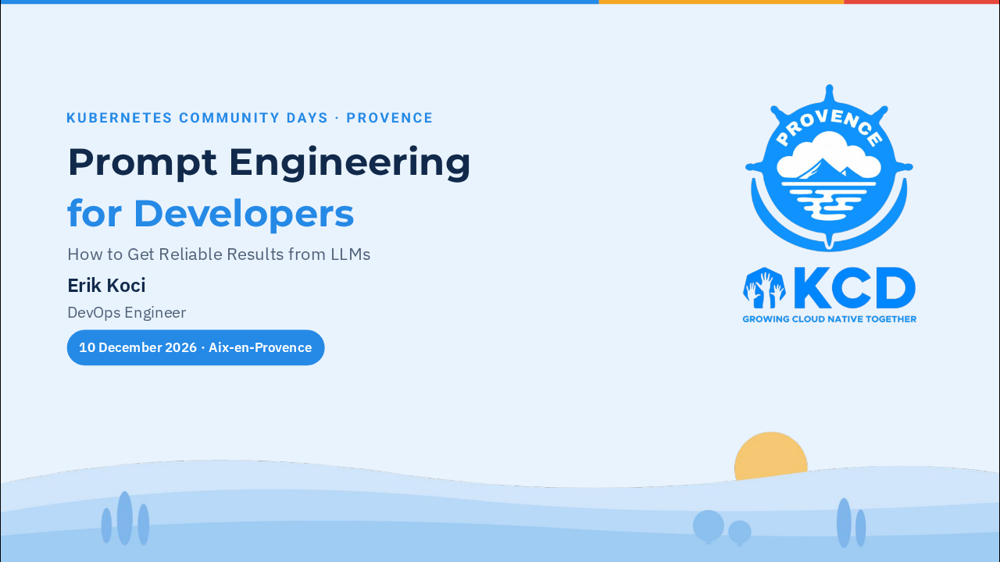
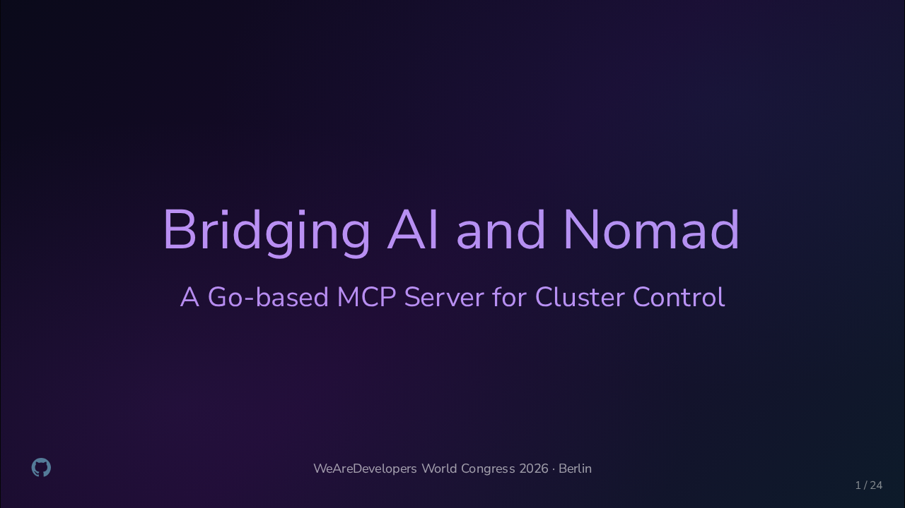

# Talks

Slides, speaker notes and demo code for my conference talks.
Each talk lives in its own folder, named `YYYY-MM-event-topic`. Click a cover to open the slides (PDF).

| | Talk |
|---|---|
| [](2026-12-kcd-provence-prompt-engineering/slides-30min-export.pdf) | **[Prompt Engineering for Developers: How to Get Reliable Results from LLMs](2026-12-kcd-provence-prompt-engineering/)**<br>KCD Provence · Aix-en-Provence · December 2026<br>Slides: [30 min PDF](2026-12-kcd-provence-prompt-engineering/slides-30min-export.pdf) · [10 min PDF](2026-12-kcd-provence-prompt-engineering/slides-10min-export.pdf) |
| [](2026-07-wearedevelopers-nomad-mcp/slides-export.pdf) | **[Bridging AI and Nomad: a Go-based MCP Server for Cluster Control](2026-07-wearedevelopers-nomad-mcp/)**<br>WeAreDevelopers World Congress · Berlin · July 2026<br>Slides: [PDF](2026-07-wearedevelopers-nomad-mcp/slides-export.pdf) · Video: [WeAreDevelopers](https://www.wearedevelopers.com/videos/2063-bridging-ai-and-nomad-a-go-based-mcp-server-for-cluster-control) |

## Running a deck

All decks are built with [Slidev](https://sli.dev/).

```bash
cd <talk-folder>
npm install
npm run dev      # exact scripts (dev, export) are in each talk README
```
